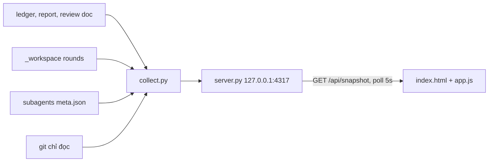

# Kế hoạch: Dashboard theo dõi harness

> Tạo ngày 2026-11-08, từ ảnh chụp dashboard mẫu `127.0.0.1:4317/#overview` (user gửi).
> Trạng thái: **D0–D5 đã làm xong 2026-11-08.** Review vòng 1 (2026-11-08), vòng 2–5 (2026-11-16) đã sửa; vòng 6 (2026-11-16) không còn high/medium → **D5 đạt**. Các lỗi low còn lại được user chấp nhận, ghi trong `_workspace/adhoc-harness-dashboard/round-6/00_main_scope.md`. Việc này thay chỗ Phase 6 (deploy) đang tạm dừng.
> Việc ngoài `screen-feature-plan.md`, nên không dùng `/plan-task`; review bằng `review-pipeline` với ID `adhoc-harness-dashboard`.

## 1. Phân tích ảnh mẫu

| Vùng trong ảnh | Nội dung | Điều đáng học |
|---|---|---|
| Sidebar | Tổng quan, Đội agent, Trao đổi; nhãn `LOCAL / READ ONLY` | Chạy local, chỉ đọc, nói rõ ngay trên giao diện |
| Header | "Đội agent đang làm gì?", tên nhiệm vụ, nút Tạm dừng cập nhật, Làm mới | Câu hỏi chính của trang là tiêu đề |
| Banner vàng | "Chưa có mốc mới trong hơn 2 phút. Đây là thời điểm cập nhật nhật ký, không phải bằng chứng agent đã dừng làm việc." | **Quan trọng nhất:** không suy diễn quá dữ liệu |
| Khối tiến độ | 38%, 6/16 mốc, "mỗi mốc có trọng số bằng nhau" | Con số đi kèm cách tính |
| 3 KPI | 5 agent, 4 đang làm, 8 lượt trao đổi | Đọc được tình hình trong vài giây |
| Dòng meta | Nguồn dữ liệu, sự kiện mới nhất, lần kết nối | Tách "dữ liệu mới" khỏi "kết nối còn sống" |
| Thẻ agent | Vai trò, id, trạng thái, ghi chú mới nhất, x/y mốc | Mỗi agent một thẻ, bấm để xem chi tiết |
| Đồ thị | Node là agent, cạnh có số lượt; "Bỏ chọn" để bỏ lọc | Bấm agent thì đồ thị và danh sách cùng lọc |

Ảnh mẫu dựa trên một nhật ký do tác nhân điều phối ghi. System_bus chưa có nhật ký như vậy, nên phần chính của kế hoạch là lấy dữ liệu thật từ những gì harness đã ghi.

## 2. Nguồn dữ liệu (đã kiểm trên repo ngày 2026-11-08)

| Nguồn | Cho biết | Ghi chú khi parse |
|---|---|---|
| `.claude/ledger/screen-feature-plan.md` | 31 task × 5 cổng (`spec, implement, test, review, lead-review`) | Hiện 64/155 mốc (41%); 12 task đủ 5 cổng, 18 task chưa bắt đầu |
| `.claude/docs/report/screen-feature-plan.md` | Task đã CLEAN, số vòng lead review, ngày | Có lịch sử trước Harness v2 |
| `.claude/docs/review/<ID>-<slug>.md` mục 7 | Verdict, các dòng `L<n>` với FIX / DEFER / NEEDS-USER | Tên file có slug, phải dò theo ID |
| `.claude/docs/review/_workspace/<ID>/round-<N>/` | Tiến độ một vòng review qua file `00_`, `01_<agent>_`, `02_`, `03_` | Chỉ có từ 2026-11-03 (`6.2`, `4.1a`, `adhoc-harness`). Bỏ qua thư mục kiểu `round-1.prev-2215` khi tính vòng hiện tại |
| `~/.claude/projects/<slug>/<session>/subagents/agent-*.meta.json` | `agentType`, `description`, `finished` của từng subagent | Riêng một session đã có 26 lần chạy. Là định dạng nội bộ, có thể đổi; ý nghĩa chính xác của `finished` phải kiểm ở D4. **Chỉ đọc `.meta.json` và `stat` file `.jsonl`, không mở nội dung transcript** |
| `git` (3 repo) | Nhánh hiện tại, commit mới nhất, file chưa commit | Lệnh chỉ đọc, có timeout |
| `.claude/agents/*.md` | Danh sách agent, model | Frontmatter |

Điểm lệch dashboard phải hiện ra, không được che:

- Task `0.3` có report "round 3, CLEAN" nhưng ledger chưa tick `lead-review`. Hiện là **"Chờ bạn duyệt"**, đúng quy tắc chỉ user được tick.
- `adhoc-harness` có review nhưng không có trong ledger. Hiện ở nhóm "Ngoài kế hoạch".
- Verdict là văn bản tự do, ví dụ `confirmed (omission that misleads; ...)`. Parse theo tiền tố; dòng không nhận ra thì đưa vào danh sách cảnh báo, không bỏ im lặng.
- Task trước 2026-11-03 không có `_workspace`. Hiện "không có dữ liệu", không hiện số 0.

## 3. Ánh xạ từ ảnh sang harness

| Ảnh mẫu | System_bus |
|---|---|
| Tên nhiệm vụ | Nhánh hiện tại và task đang có vòng review mới nhất |
| 6/16 mốc | Số cổng ledger đã tick / tổng (ví dụ ngày 2026-11-08: 64/155), ghi rõ "mỗi cổng trọng số bằng nhau"; dòng phụ không tính phase tạm dừng (cùng ngày: 59/120). Số thật lấy từ `collect.py --check` lúc chạy |
| 5 agent | 6 subagent + "Điều phối" (session chính) + thẻ **"Bạn"** (các cổng chờ người) |
| 4 đang làm | Subagent có `finished` chưa đặt và file transcript vừa ghi gần đây |
| 8 lượt trao đổi | Số finding đi qua pipeline trong vòng đang xem |
| Thẻ agent x/y mốc | Số lần chạy, finding theo severity, tỉ lệ confirmed / refuted, kết quả mới nhất |
| Đồ thị ai trao đổi với ai | `Điều phối → reviewer → finding-verifier → 03_summary → lead-review → Bạn`, số trên cạnh là số finding |
| Banner vàng | "Chưa có thay đổi mới trong hơn N phút. Đây là thời điểm file được ghi, không phải bằng chứng agent đã dừng." |

Khác biệt cần biết: subagent ở đây **không nói chuyện trực tiếp với nhau**, mà trao đổi qua file do session chính điều phối. Vì vậy cạnh trên đồ thị là luồng finding, không phải tin nhắn.

Trạng thái agent: `Đang chạy`, `Xong`, `Không rõ` (`finished` chưa đặt nhưng file đã lâu không đổi, ví dụ session bị ngắt), `Nhàn rỗi`. Không suy đoán thành "Lỗi". Ngưỡng theo lần ghi transcript gần nhất (`RUNNING_WINDOW`, `RECENT_WINDOW` trong `collect.py`): `finished` chưa đặt và ≤ 120 giây → `Đang chạy`; 120 giây – 30 phút → `Không rõ`; cũ hơn → `Nhàn rỗi`. `finished: true` trong 30 phút → `Xong`, sau đó `Nhàn rỗi`. Nguồn subagent lỗi hoặc meta sai định dạng → mọi thẻ `Không rõ`.

Bổ sung so với ảnh: tab **Task**, ma trận 31 task × 5 cổng lọc theo phase, vì đơn vị làm việc chính của harness là task. Phase 6 mang nhãn "Tạm dừng".

## 4. Thiết kế

- **Vị trí:** `.claude/dashboard/` trong repo gốc: `collect.py`, `server.py`, `test_collect.py` (dữ liệu mẫu dựng trong test), `static/`.
- **Công nghệ:** Python stdlib (hook đã cần `python3`), HTML + CSS + JS thuần, đồ thị SVG inline. Không npm, không build. Không đặt trong `booking_ticket_vue/` để công cụ nội bộ không lọt vào bản build production.
- **Chạy:** `python3 .claude/dashboard/server.py [--port 4317]`.
- **Cập nhật:** poll 5 giây; "Tạm dừng cập nhật" dừng poll; "Làm mới" lấy ngay. Snapshot trả `generatedAt`, `lastChangeAt` (mtime mới nhất), `warnings[]`. Mất kết nối thì giữ dữ liệu cũ và báo rõ.
- **Giao diện:** nền tối theo ảnh mẫu, màu định nghĩa bằng token, dùng được ở màn hình hẹp, trạng thái có cả chữ chứ không chỉ màu.

An toàn (nối tiếp hook hardening 2026-11-03):

- Chỉ bind `127.0.0.1`, chỉ GET và HEAD (POST, PUT, PATCH, DELETE, OPTIONS, TRACE, CONNECT trả 405; method lạ và request hỏng trả lỗi JSON `bad_request` với mã do `http.server` đặt, ví dụ 501; mọi trường hợp đều kèm header an toàn), kiểm header `Host` (chống DNS rebinding), không bật CORS.
- `/api/snapshot` từ chối `Sec-Fetch-Site` khác `same-origin`/`none`. Mọi response có CSP, `nosniff`, `Referrer-Policy: no-referrer`, `Cache-Control: no-store`, `Cross-Origin-Resource-Policy: same-origin`.
- Danh sách đường dẫn cho phép cố định, không có tham số đường dẫn từ client, không theo symlink ra ngoài (file hoặc thư mục symlink bị bỏ qua kèm cảnh báo), không đọc FIFO. Không bao giờ mở `.env*`. Git chạy với `--no-optional-locks` và `core.fsmonitor=false`.
- Nội dung review là dữ liệu không tin cậy: render bằng `textContent`, không dùng `innerHTML`.
- Ô văn bản khớp mẫu secret (`secret_findings` của hook cộng các mẫu riêng của dashboard) thì hiện `<redacted>`, vì file `_workspace` không được Stop hook quét.
- Dashboard không ghi file nào, không tick ledger, không kích hoạt agent.

## 5. Các bước

| # | Việc | Cỡ | Kiểm |
|---|---|---|---|
| D0 | `collect.py` + fixtures: parser ledger, report, review doc, `_workspace` | M | Unit test trên fixtures gồm các ca lệch ở mục 2; `collect.py --check` trên repo thật khớp ledger tại thời điểm chạy, không cảnh báo |
| D1 | `server.py`: `/api/snapshot`, static, các rào an toàn | S | Test `Host` lạ bị từ chối, POST bị từ chối, snapshot không chứa nội dung `.env` hay transcript. Bổ sung sau review vòng 2–3: đủ header an toàn trên 200/404/405, `Sec-Fetch-Site`, FIFO không làm treo, symlink bị bỏ qua kèm cảnh báo, `main()` thoát mã 1 khi thiếu bộ quét hoặc trùng cổng |
| D2 | UI tab Tổng quan: header, banner, tiến độ, KPI, thẻ agent, đồ thị | M | Chạy thật trên trình duyệt, đối chiếu số với ledger; tạm dừng và làm mới hoạt động |
| D3 | Tab Đội agent, Trao đổi (timeline vòng review), Task (ma trận); lọc theo agent | M | Bấm agent thì lọc đồng bộ; vòng `4.1a` round 2 hiện đúng 8 finding |
| D4 | Trạng thái subagent trực tiếp từ `.meta.json`; banner dữ liệu cũ | S | Trong lúc chạy `/parallel-review` thật, thẻ đổi trạng thái; đổi định dạng meta trong fixture thì hiện cảnh báo, không sập |
| D5 | Tài liệu và review: bảng Change history trong `CLAUDE.md`, `VIBE_CODE_INSTRUCTIONS.md`, `CLAUDE_CAPABILITY_ROADMAP.md`; `review-pipeline` (`config-reviewer`, `security-reviewer`) | S | Summary không còn high/medium |

Làm trên nhánh mới `task/harness-dashboard` tách từ HEAD của `task/4.1a-profile-avatar`, vì `develop` local đang chậm 11 commit và thiếu Harness v2. Merge PR 4.1a trước thì PR dashboard mới sạch. D0 → D1 → D2 → D3 → D4 → D5. Dùng được từ sau D2.

Bổ sung cho D0–D1 (chốt 2026-11-08):

- D0: khớp ID theo `<ID>-` để `4.1` không dính `4.1a`; `02_` là bước không bắt buộc; một hàm duy nhất quyết định trạng thái task (Xong → Tạm dừng → Chờ bạn duyệt → Đang review → Đang làm → Chưa bắt đầu; "Chờ bạn duyệt" gồm report CLEAN chưa tick `lead-review`, và có file `<ID>-<slug>.md` chưa tick `spec`); mỗi nguồn lỗi độc lập; `git --no-optional-locks` và cache 30 giây; lệnh `collect.py --check`.
- D1: không có tùy chọn `--host`; danh sách file tĩnh cố định; che secret một chỗ trước khi trả JSON, không nạp được bộ quét thì từ chối phục vụ; chỉ gửi trường cần hiển thị (bỏ "How to check"); thêm CSP, `nosniff`, `no-store`; cache snapshot 2 giây; trùng cổng thì báo lỗi và thoát.

## 6. Quyết định đã chốt (2026-11-08, user)

| # | Câu hỏi | Quyết định |
|---|---|---|
| Q1 | Trạng thái agent trực tiếp lấy từ đâu? | **`.meta.json`** (không sửa hook). `finished` hiện chỉ có `true` hoặc `null`. Định dạng đổi thì thẻ hiện "Không rõ" và có cảnh báo. Nếu sau này cần ổn định hơn, thêm hook `SubagentStart`/`SubagentStop` |
| Q2 | Giao diện | Tối, 3 tab như ảnh, thêm tab Task |
| Q3 | Vị trí | `.claude/dashboard/` |

## 7. Ngoài phạm vi

Thao tác từ dashboard (tick ledger, chạy lại review), token và chi phí, nhiều người dùng, truy cập từ xa, dữ liệu lịch sử dạng time-series.
